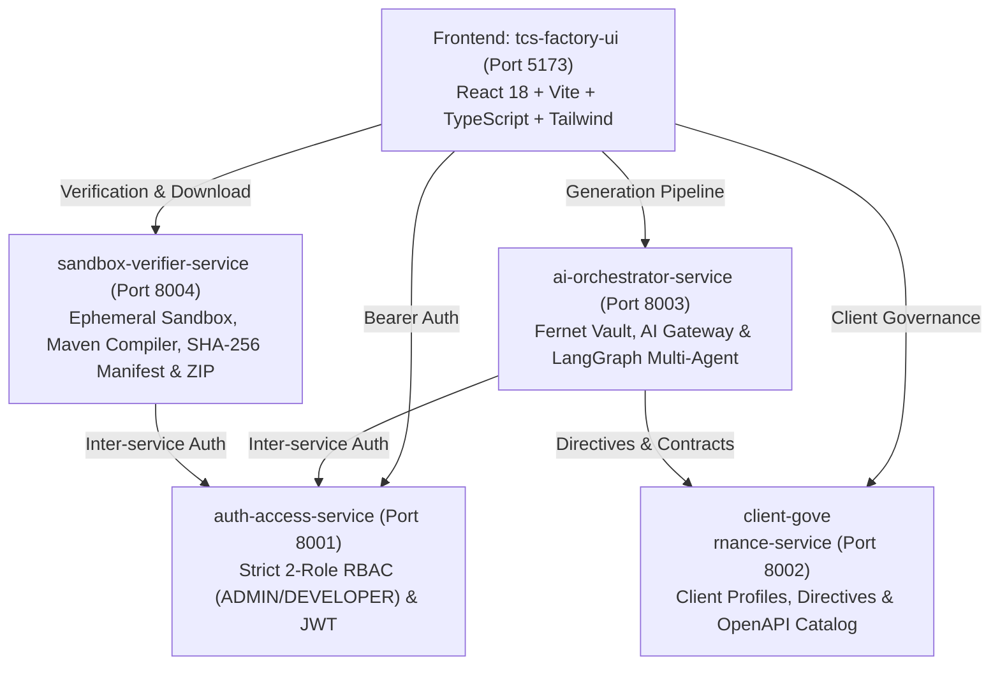

# TCS Intelligent Microservice Factory 🚀

> **Autonomous Enterprise Multi-Agent Microservice Factory for Tata Consultancy Services (TCS)**  
> Generates clean, modular, and verified Java + Quarkus microservices based on business requirements, OpenAPI 3.x contracts, and client governance directives with deterministic verification and Zero Hardcoding.

---

## 🏛️ Architecture Overview

The platform is designed as a distributed suite of 4 decoupled microservices plus an enterprise web SPA frontend ("Workspace Studio"):



| Microservice | Port | Description | Stack |
|---|:---:|---|---|
| **`auth-access-service`** | `8001` | User management, strict 2-Role RBAC (`ADMIN` / `DEVELOPER`), JWT tokens, clean bootstrap (`/setup-admin`), client isolation. | FastAPI, SQLAlchemy, SQLite/PostgreSQL, PyJWT |
| **`client-governance-service`** | `8002` | Agnostic client profiles (e.g. BCP as reference pilot), versioned technical directives (`MANDATORY`, `RECOMMENDED`, `OPTIONAL`), OpenAPI 3.x specifications catalog. | FastAPI, SQLAlchemy, Pydantic v2, PyYAML |
| **`ai-orchestrator-service`** | `8003` | Fernet-encrypted credentials vault, AI Gateway with hot-switching (Gemini, DeepSeek, Grok, Mock), 5-node LangGraph pipeline with graceful fallback, token & cost telemetry. | FastAPI, LangGraph, Fernet, HTTPX |
| **`sandbox-verifier-service`** | `8004` | Ephemeral compilation sandbox with path-traversal security, deterministic syntax/Maven compiler, SHA-256 cryptographic manifest generator, `.zip` packager. | FastAPI, SQLAlchemy, Zipfile, Hashlib |
| **`tcs-factory-ui`** | `5173` | Corporate Workspace Studio with official TCS branding (`#00142D`, `#0076CE`, `#00A3E0`), zero-state wizard, interactive code viewer (HITL), compiler console. | React 18, Vite, TypeScript, Tailwind CSS |

---

## ⚡ Core Principles (Constitution v1.2.0)

1. **Adaptive Architectural Styles (No One-Size-Fits-All)**:
   - Supports Hexagonal (Ports & Adapters), Clean Layered, Event-Driven (Reactive Messaging / Kafka), BFF Aggregator, and high-performance gRPC based on actual service needs.
2. **Capacities Strictly On-Demand**:
   - Zero unnecessary bloat. Persistence (Panache/Hibernate), messaging, and security are injected ONLY when explicitly justified by functional requirements.
3. **Zero Preloaded Data & Clean Bootstrap**:
   - Databases start 100% clean. The initial SuperAdmin is created on first boot via `/setup-admin`.
4. **Strict Two-Role RBAC**:
   - `ADMIN`: Manages collaborators, client assignments, AI vault, and global governance.
   - `DEVELOPER`: Strictly restricted to assigned client accounts; generates, edits (HITL), and verifies microservices.
5. **Zero Hardcoding**:
   - Platform core contains zero hardcoded client logic. BCP serves purely as the demanding banking reference account.
6. **Cryptographic Verification (SHA-256)**:
   - Every packaged microservice includes `VERIFICATION_MANIFEST.json` containing cryptographic SHA-256 hashes of all source files.

---

## 🚀 Quickstart

### Prerequisites
- Python 3.11+
- Node.js 18+ (tested on v24)
- Git

### 1. Launch All Microservices & UI
Run the universal cluster launcher:

```powershell
python scripts/start_factory.py
```
*(Or run `powershell -ExecutionPolicy Bypass -File .\scripts\start_factory.ps1`)*

The launcher spins up all 4 microservices and the Vite frontend:
* **Frontend Workspace Studio:** [http://localhost:5173](http://localhost:5173)
* **Auth Service API:** [http://localhost:8001/api/v1/health](http://localhost:8001/api/v1/health)
* **Governance Service API:** [http://localhost:8002/api/v1/health](http://localhost:8002/api/v1/health)
* **AI Orchestrator API:** [http://localhost:8003/api/v1/health](http://localhost:8003/api/v1/health)
* **Sandbox Verifier API:** [http://localhost:8004/api/v1/health](http://localhost:8004/api/v1/health)

### 2. Seed Reference Profile (BCP)
Populate the reference pilot account with its 9 technical directives and OpenAPI transfer contract:

```powershell
python scripts/seed_bcp_profile.py
```

### 3. Run All Test Suites
Execute the unified test runner with subprocess isolation across all 4 microservices:

```powershell
python scripts/run_all_tests.py
```
**Result:** 68/68 tests passing (100% success rate).

---

## 📂 Project Structure

```text
quakus/
├── scripts/
│   ├── run_all_tests.py            # Unified test runner (isolated subprocesses)
│   ├── seed_bcp_profile.py         # Seeds BCP client profile, directives & OpenAPI spec
│   ├── start_factory.py            # Cross-platform cluster orchestrator
│   ├── start_factory.ps1           # PowerShell cluster launcher
│   └── start_factory.bat           # Windows batch launcher
├── services/
│   ├── auth-access-service/        # Port 8001: 2-Role RBAC & JWT auth
│   ├── client-governance-service/  # Port 8002: Profiles & directives
│   ├── ai-orchestrator-service/    # Port 8003: Fernet vault & LangGraph multi-agent
│   ├── sandbox-verifier-service/   # Port 8004: Ephemeral sandbox compiler & packager
│   └── tcs-factory-ui/             # Port 5173: React + Vite + TS Workspace Studio
├── specs/                          # Spec-Driven Development specifications (001 to 005)
└── README.md
```

---

## 🛡️ License

Tata Consultancy Services © 2026. All Rights Reserved.

