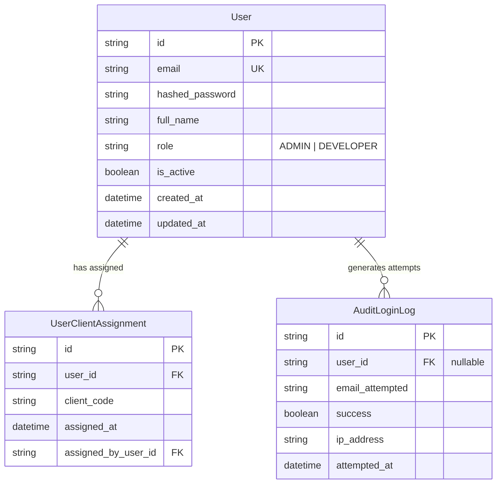

# Phase 1 Data Model: Spec 001 — auth-access-service

## 1. Domain Entities & Database Schema

### 1.1 `users` Table
Stores corporate collaborators and administrators.

| Column | Type | Constraints | Description |
|---|---|---|---|
| `id` | VARCHAR(36) | PRIMARY KEY | UUIDv4 string identifier |
| `email` | VARCHAR(255) | UNIQUE, NOT NULL, INDEX | Corporate email (e.g., user@tcs.com) |
| `hashed_password` | VARCHAR(255) | NOT NULL | Bcrypt hash ($2b$12$...) |
| `full_name` | VARCHAR(255) | NOT NULL | Colleague full name |
| `role` | VARCHAR(20) | NOT NULL | Corporate role: `'ADMIN'` or `'DEVELOPER'` |
| `is_active` | BOOLEAN | NOT NULL, DEFAULT TRUE | Account operational status |
| `created_at` | DATETIME | NOT NULL | UTC creation timestamp |
| `updated_at` | DATETIME | NOT NULL | UTC last update timestamp |

### 1.2 `user_client_assignments` Table
Maps developer colleagues to authorized client account codes for isolation.

| Column | Type | Constraints | Description |
|---|---|---|---|
| `id` | VARCHAR(36) | PRIMARY KEY | UUIDv4 string identifier |
| `user_id` | VARCHAR(36) | NOT NULL, FK(`users.id`), INDEX | Reference to assigned user |
| `client_code` | VARCHAR(64) | NOT NULL, INDEX | Standardized slug of client account (e.g. `bcp`, `retail-corp`) |
| `assigned_at` | DATETIME | NOT NULL | UTC assignment timestamp |
| `assigned_by_user_id` | VARCHAR(36) | NOT NULL, FK(`users.id`) | Admin who granted access |

*Unique Constraint*: `UNIQUE(user_id, client_code)` to prevent duplicates.

### 1.3 `audit_login_logs` Table
Audit trail of login attempts.

| Column | Type | Constraints | Description |
|---|---|---|---|
| `id` | VARCHAR(36) | PRIMARY KEY | UUIDv4 string identifier |
| `user_id` | VARCHAR(36) | NULLABLE, FK(`users.id`) | User if found, NULL otherwise |
| `email_attempted` | VARCHAR(255) | NOT NULL | Email input used in attempt |
| `success` | BOOLEAN | NOT NULL | True if login succeeded, False otherwise |
| `ip_address` | VARCHAR(45) | NOT NULL | Client IP address (IPv4/IPv6) |
| `attempted_at` | DATETIME | NOT NULL | UTC timestamp of attempt |

---

## 2. Entity Relationships (ERD)

---

## 3. Pydantic Schemas

### 3.1 Authentication
- `LoginRequest`:
  - `email`: `EmailStr`
  - `password`: `str`
- `TokenResponse`:
  - `access_token`: `str`
  - `token_type`: `str = "bearer"`
  - `user`: `UserResponse`
- `TokenVerifyRequest`:
  - `token`: `str`
- `TokenVerifyResponse`:
  - `valid`: `bool`
  - `user_id`: `Optional[str] = None`
  - `email`: `Optional[str] = None`
  - `role`: `Optional[str] = None`
  - `assigned_clients`: `List[str] = []`
  - `reason`: `Optional[str] = None`

### 3.2 User Management
- `UserCreate`:
  - `email`: `EmailStr`
  - `password`: `str` (min length 8)
  - `full_name`: `str`
  - `role`: `Literal["ADMIN", "DEVELOPER"]`
- `UserUpdate`:
  - `full_name`: `Optional[str] = None`
  - `role`: `Optional[Literal["ADMIN", "DEVELOPER"]] = None`
  - `is_active`: `Optional[bool] = None`
  - `password`: `Optional[str] = None`
- `UserResponse`:
  - `id`: `str`
  - `email`: `str`
  - `full_name`: `str`
  - `role`: `str`
  - `is_active`: `bool`
  - `created_at`: `datetime`
  - `assigned_clients`: `List[str] = []`
- `ClientAssignmentUpdate`:
  - `client_codes`: `List[str]`

