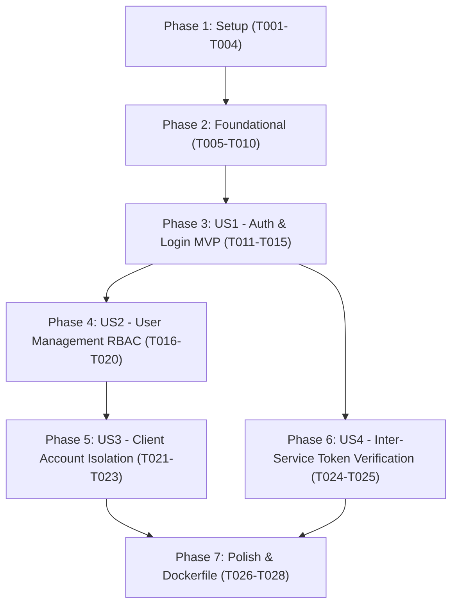

# Tasks: Spec 001 — auth-access-service

**Input**: Design documents from `/specs/001-auth-access-service/` (`spec.md`, `plan.md`, `research.md`, `data-model.md`, `contracts/openapi.json`, `quickstart.md`)
**Version Alignment**: Constitution `v1.2.0` (Principles IV, XIII, XIV)

## Format: `[ID] [P?] [Story] Description`
- **[P]**: Can run in parallel (different files, no dependencies)
- **[Story]**: Associated User Story (`[US1]`, `[US2]`, `[US3]`, `[US4]`)

---

## Phase 1: Setup (Shared Infrastructure)

**Purpose**: Microservice directory structure, virtual environment configuration, and core dependencies.

- [x] T001 Create microservice directory structure in `services/auth-access-service/app/` (`api/v1`, `core`, `models`, `schemas`) and `services/auth-access-service/tests/` per implementation plan.
- [x] T002 [P] Create `services/auth-access-service/requirements.txt` with frozen dependencies (`fastapi`, `uvicorn`, `pydantic>=2.0`, `sqlalchemy>=2.0`, `pyjwt`, `passlib[bcrypt]`, `python-dotenv`, `pytest`, `httpx`).
- [x] T003 [P] Create `services/auth-access-service/app/core/config.py` with Pydantic `BaseSettings` for `PORT=8001`, `JWT_SECRET_KEY`, `JWT_ALGORITHM`, `DATABASE_URL` (defaulting to SQLite `sqlite:///./auth_factory_local.db`).
- [x] T004 [P] Create `services/auth-access-service/app/core/database.py` with SQLAlchemy engine, `sessionmaker`, and declarative `Base`.

---

## Phase 2: Foundational (Blocking Prerequisites)

**Purpose**: Core security hashing, JWT generation, database models, and FastAPI application scaffolding.

- [x] T005 Implement password hashing (bcrypt) and JWT encode/decode helpers in `services/auth-access-service/app/core/security.py`.
- [x] T006 [P] Create domain ORM models (`User`, `UserRole`, `UserClientAssignment`, `AuditLoginLog`) in `services/auth-access-service/app/models/`.
- [x] T007 [P] Create base Pydantic schemas in `services/auth-access-service/app/schemas/` (`UserResponse`, `UserCreate`, `UserUpdate`, `LoginRequest`, `TokenResponse`, `TokenVerifyResponse`).
- [x] T008 Implement auth dependency injection in `services/auth-access-service/app/api/deps.py` (`get_db`, `get_current_user`, `require_admin`).
- [x] T009 Create FastAPI application entrypoint in `services/auth-access-service/app/main.py` with CORS, database table initialization on startup, and health check endpoint `GET /api/v1/health`.
- [x] T010 [P] Setup test infrastructure and fixtures in `services/auth-access-service/tests/conftest.py` with SQLite in-memory database and FastAPI `TestClient`.

**Checkpoint**: Foundation ready. Microservice starts on port 8001 with `/api/v1/health` and test runner configured.

---

## Phase 3: User Story 1 - Autenticación Segura y Emisión de JWT (Priority: P1) [MVP]

**Goal**: Enable zero-state initialization via `/setup-admin`, secure user authentication via `/login`, JWT issuance with role claims, and current user profile retrieval `/me`.

**Independent Test**: Execute `test_auth.py` verifying `/setup-admin` creates the first admin, second call returns 409, login issues valid JWT, and `/me` returns user profile.

### Tests for User Story 1
- [x] T011 [P] [US1] Create automated tests in `services/auth-access-service/tests/test_auth.py` for `/setup-admin` (initial success, subsequent 409 conflict), `/login` (valid credentials, invalid credentials, inactive user), and `GET /api/v1/auth/me`.

### Implementation for User Story 1
- [x] T012 [US1] Implement `POST /api/v1/auth/setup-admin` in `services/auth-access-service/app/api/v1/auth.py` to allow creating the initial administrator only when database is empty (Zero Preloaded Data principle).
- [x] T013 [US1] Implement `POST /api/v1/auth/login` in `services/auth-access-service/app/api/v1/auth.py` with password verification, audit logging in `audit_login_logs`, and JWT issuance.
- [x] T014 [US1] Implement `GET /api/v1/auth/me` in `services/auth-access-service/app/api/v1/auth.py` returning the authenticated user profile.
- [x] T015 [US1] Wire authentication router into `services/auth-access-service/app/api/v1/api.py`.

**Checkpoint**: User Story 1 is fully functional and tested independently.

---

## Phase 4: User Story 2 - Gestión de Colaboradores y Asignación de 2 Roles (Priority: P1)

**Goal**: Enable Administrators to list, create, and update users with strictly two roles (`ADMIN` or `DEVELOPER`), while blocking Developers with 403 Forbidden.

**Independent Test**: Execute `test_users.py` confirming Admin can create users and list them, while Developer receives 403 Forbidden. Admin self-deactivation guard is enforced.

### Tests for User Story 2
- [x] T016 [P] [US2] Create automated tests in `services/auth-access-service/tests/test_users.py` testing user creation by Admin, role enforcement (`ADMIN` / `DEVELOPER` only), rejection with 403 for Developer caller, and prevention of self-deactivation for sole admin.

### Implementation for User Story 2
- [x] T017 [US2] Implement user repository/service logic in `services/auth-access-service/app/api/v1/users.py` for listing users with pagination and filtering.
- [x] T018 [US2] Implement `POST /api/v1/users` in `services/auth-access-service/app/api/v1/users.py` requiring `ADMIN` role and enforcing email uniqueness and role enum validation.
- [x] T019 [US2] Implement `PATCH /api/v1/users/{user_id}` in `services/auth-access-service/app/api/v1/users.py` with check preventing self-deactivation if caller is the last active admin.
- [x] T020 [US2] Wire users router into `services/auth-access-service/app/api/v1/api.py`.

**Checkpoint**: User Stories 1 and 2 are fully functional and pass tests.

---

## Phase 5: User Story 3 - Asignación y Aislamiento de Cuentas de Clientes por Desarrollador (Priority: P2)

**Goal**: Admins assign authorized client codes to Developers; Developers only see their assigned clients, while Admins have universal client access.

**Independent Test**: Execute `test_client_access.py` verifying that Admin assigning clients updates database, and Developer querying `/auth/me/clients` receives only authorized codes.

### Tests for User Story 3
- [x] T021 [P] [US3] Create automated tests in `services/auth-access-service/tests/test_client_access.py` verifying client assignment endpoint, isolation per developer, and wildcard/universal access for admin.

### Implementation for User Story 3
- [x] T022 [US3] Implement `PUT /api/v1/users/{user_id}/assigned-clients` in `services/auth-access-service/app/api/v1/users.py` to overwrite/sync client codes in `user_client_assignments`.
- [x] T023 [US3] Implement `GET /api/v1/auth/me/clients` in `services/auth-access-service/app/api/v1/auth.py` returning assigned client codes for `DEVELOPER`, or wildcard `["*"]` for `ADMIN`.

**Checkpoint**: Client account isolation is complete and tested.

---

## Phase 6: User Story 4 - Verificación de Tokens Inter-Servicio (Priority: P2)

**Goal**: Expose `POST /api/v1/auth/verify` for the other microservices in the TCS Factory suite (`client-governance`, `ai-orchestrator`, `sandbox-verifier`) to validate tokens and permissions.

**Independent Test**: Execute test verifying that calling `/auth/verify` with a valid JWT returns `{ valid: true, user_id, role, assigned_clients }` in < 20ms, and invalid/expired tokens return `{ valid: false, reason }`.

### Tests for User Story 4
- [x] T024 [P] [US4] Add tests in `services/auth-access-service/tests/test_auth.py` validating `POST /api/v1/auth/verify` with valid token, expired token, tampered token, and inactive user token.

### Implementation for User Story 4
- [x] T025 [US4] Implement `POST /api/v1/auth/verify` in `services/auth-access-service/app/api/v1/auth.py` parsing JWT, verifying against database user status, retrieving client assignments, and returning `TokenVerifyResponse`.

**Checkpoint**: All 4 user stories are functional and covered by unit/integration tests.

---

## Phase 7: Polish & Operational Hardening

**Purpose**: Containerization, production documentation, and execution validation.

- [x] T026 [P] Create `services/auth-access-service/Dockerfile` targeting Python 3.11-slim, exposing port 8001.
- [x] T027 [P] Create `services/auth-access-service/README.md` documenting API routes, environment variables, and Docker run commands.
- [x] T028 Run the complete test suite (`pytest`) and verify 100% passing tests and response times under 250ms.

---

## Dependencies & Execution Order

### Parallel Opportunities
- Within Phase 1: `T002`, `T003`, `T004` can run in parallel.
- Within Phase 2: `T006` (models), `T007` (schemas), `T010` (test fixtures) can run in parallel.
- Tests within each user story (`T011`, `T016`, `T021`, `T024`) are written and validated before corresponding endpoints.
