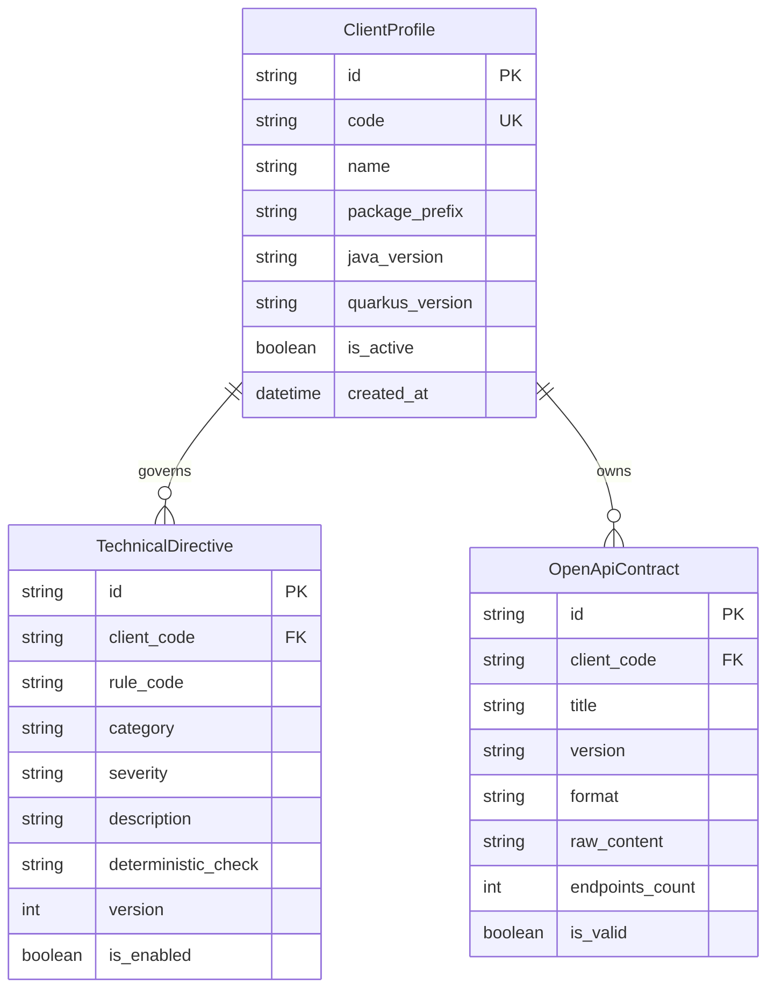

# Phase 1 Data Model: Spec 002 — client-governance-service

## 1. Domain Entities & Database Schema

### 1.1 `client_profiles` Table
Stores enterprise client account settings and technical baselines.

| Column | Type | Constraints | Description |
|---|---|---|---|
| `id` | VARCHAR(36) | PRIMARY KEY | UUIDv4 string identifier |
| `code` | VARCHAR(64) | UNIQUE, NOT NULL, INDEX | Standard client slug (e.g. `bcp`, `retail-corp`) |
| `name` | VARCHAR(255) | NOT NULL | Formal client company name |
| `description` | TEXT | NULLABLE | Client overview, guidelines, and context |
| `package_prefix` | VARCHAR(255) | NOT NULL, DEFAULT `'com.tcs.generated'` | Base Java package namespace (e.g. `com.bcp.enterprise`) |
| `java_version` | VARCHAR(10) | NOT NULL, DEFAULT `'17'` | Target LTS Java version (`17` or `21`) |
| `quarkus_version` | VARCHAR(20) | NOT NULL, DEFAULT `'3.15.1'` | Target Quarkus BOM version |
| `is_active` | BOOLEAN | NOT NULL, DEFAULT TRUE | Status of the client profile |
| `created_at` | DATETIME | NOT NULL | UTC creation timestamp |
| `updated_at` | DATETIME | NOT NULL | UTC last update timestamp |

### 1.2 `technical_directives` Table
Catalog of architecture, security, and coding rules specific to a client.

| Column | Type | Constraints | Description |
|---|---|---|---|
| `id` | VARCHAR(36) | PRIMARY KEY | UUIDv4 string identifier |
| `client_code` | VARCHAR(64) | NOT NULL, INDEX | Associated client slug |
| `rule_code` | VARCHAR(100) | NOT NULL | Standard rule identifier (e.g. `MANDATORY_RESILIENCE_CB`) |
| `category` | VARCHAR(30) | NOT NULL | `SECURITY`, `ARCHITECTURE`, `NAMING`, `TESTING`, `OBSERVABILITY` |
| `severity` | VARCHAR(20) | NOT NULL | `MANDATORY`, `RECOMMENDED`, `OPTIONAL` |
| `description` | TEXT | NOT NULL | Rule description, rationale, and instructions |
| `deterministic_check` | VARCHAR(255) | NULLABLE | Deterministic check identifier or AST matcher pattern |
| `version` | INTEGER | NOT NULL, DEFAULT 1 | Incremental rule revision version |
| `is_enabled` | BOOLEAN | NOT NULL, DEFAULT TRUE | Whether rule is currently active |
| `created_at` | DATETIME | NOT NULL | UTC creation timestamp |

*Unique Constraint*: `UNIQUE(client_code, rule_code)` to prevent rule duplication per client.

### 1.3 `openapi_contracts` Table
Catalog of uploaded and parsed OpenAPI/Swagger contracts for microservice generation.

| Column | Type | Constraints | Description |
|---|---|---|---|
| `id` | VARCHAR(36) | PRIMARY KEY | UUIDv4 string identifier |
| `client_code` | VARCHAR(64) | NOT NULL, INDEX | Associated client slug |
| `title` | VARCHAR(255) | NOT NULL | API specification title |
| `version` | VARCHAR(50) | NOT NULL | API contract version (e.g. `1.0.0`) |
| `format` | VARCHAR(10) | NOT NULL | `json` or `yaml` |
| `raw_content` | TEXT | NOT NULL | Full OpenAPI specification string |
| `endpoints_count` | INTEGER | NOT NULL, DEFAULT 0 | Count of parsed paths/operations |
| `is_valid` | BOOLEAN | NOT NULL, DEFAULT TRUE | Structural validation outcome |
| `created_at` | DATETIME | NOT NULL | UTC creation timestamp |

---

## 2. Entity Relationships (ERD)

