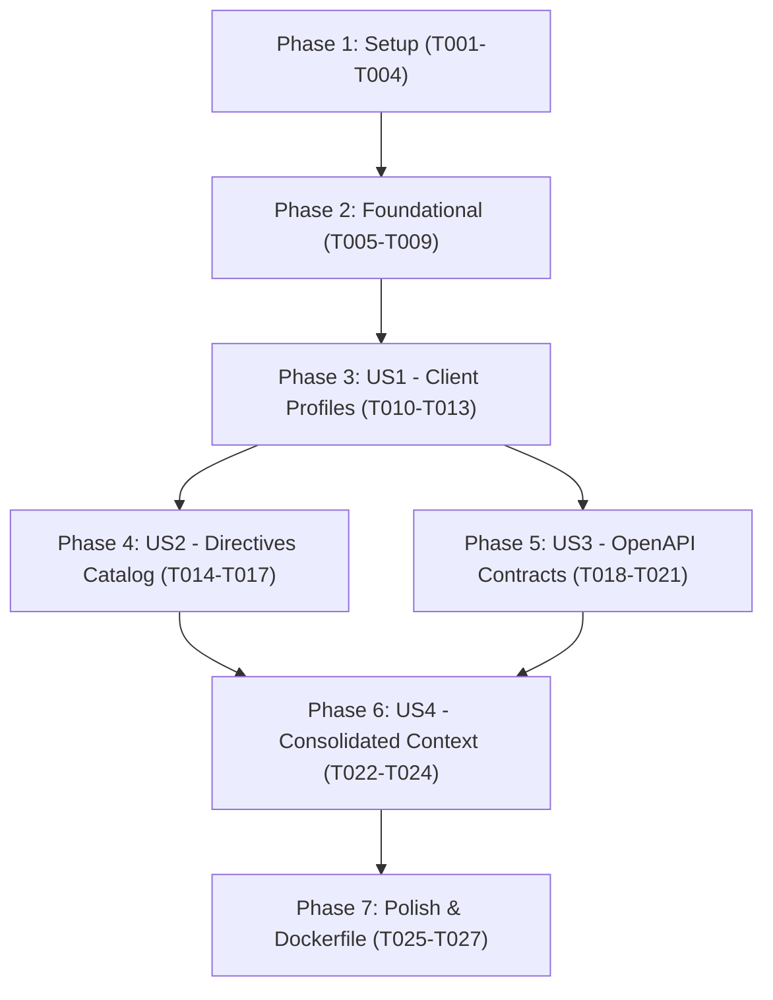

# Tasks: Spec 002 — client-governance-service

**Input**: Design documents from `/specs/002-client-governance-service/` (`spec.md`, `plan.md`, `research.md`, `data-model.md`, `contracts/openapi.json`, `quickstart.md`)
**Version Alignment**: Constitution `v1.2.0` (Principles III, V, XIII, XIV)

## Format: `[ID] [P?] [Story] Description`
- **[P]**: Can run in parallel (different files, no dependencies)
- **[Story]**: Associated User Story (`[US1]`, `[US2]`, `[US3]`, `[US4]`)

---

## Phase 1: Setup (Shared Infrastructure)

**Purpose**: Microservice directory structure, dependencies, and configuration.

- [x] T001 Create microservice directory structure in `services/client-governance-service/app/` (`api/v1`, `core`, `models`, `schemas`) and `services/client-governance-service/tests/`.
- [x] T002 [P] Create `services/client-governance-service/requirements.txt` with dependencies (`fastapi`, `uvicorn`, `pydantic>=2.0`, `pyyaml`, `sqlalchemy>=2.0`, `pyjwt`, `httpx`, `python-dotenv`, `pytest`).
- [x] T003 [P] Create `services/client-governance-service/app/core/config.py` with settings for `PORT=8002`, `DATABASE_URL` (SQLite `sqlite:///./governance_factory_local.db`), `AUTH_SERVICE_VERIFY_URL`, `JWT_SECRET_KEY`, `JWT_ALGORITHM`.
- [x] T004 [P] Create `services/client-governance-service/app/core/database.py` with SQLAlchemy engine, `sessionmaker`, and declarative `Base`.

---

## Phase 2: Foundational (Blocking Prerequisites)

**Purpose**: Domain models, schemas, auth verification dependencies, and base FastAPI application on port 8002.

- [x] T005 [P] Create domain ORM models (`ClientProfile`, `TechnicalDirective`, `OpenApiContract`) in `services/client-governance-service/app/models/`.
- [x] T006 [P] Create Pydantic v2 schemas in `services/client-governance-service/app/schemas/` (`client.py`, `directive.py`, `contract.py`, `governance.py`).
- [x] T007 Implement authentication & tenant access verification dependency in `services/client-governance-service/app/api/deps.py` (`get_verified_user`, `require_client_access`, `require_admin`).
- [x] T008 Create FastAPI application entrypoint in `services/client-governance-service/app/main.py` on port 8002 with CORS, DB initialization on startup, and `GET /api/v1/health`.
- [x] T009 [P] Setup test infrastructure and fixtures in `services/client-governance-service/tests/conftest.py` with in-memory SQLite and auth simulation fixtures.

**Checkpoint**: Foundation ready. Microservice starts on port 8002 with `/api/v1/health` and test fixtures configured.

---

## Phase 3: User Story 1 - Gestión Dinámica de Perfiles de Cliente (Priority: P1) [MVP]

**Goal**: Admins can create and manage client accounts; Developers can only list and inspect accounts they are assigned to.

**Independent Test**: Execute `test_clients.py` verifying client creation, slug validation, duplicate rejection, and strict developer isolation.

### Tests for User Story 1
- [x] T010 [P] [US1] Create automated tests in `services/client-governance-service/tests/test_clients.py` for client creation by Admin, duplicate slug rejection (409), developer restricted listing, and 403 when accessing unauthorized client.

### Implementation for User Story 1
- [x] T011 [US1] Implement `GET /api/v1/clients` and `POST /api/v1/clients` in `services/client-governance-service/app/api/v1/clients.py`.
- [x] T012 [US1] Implement `GET /api/v1/clients/{client_code}` and `PATCH /api/v1/clients/{client_code}` in `services/client-governance-service/app/api/v1/clients.py` enforcing client access isolation.
- [x] T013 [US1] Wire clients router into `services/client-governance-service/app/api/v1/api.py`.

**Checkpoint**: User Story 1 is fully functional and tested independently.

---

## Phase 4: User Story 2 - Catalogación y Versionado de Directivas Técnicas (Priority: P1)

**Goal**: Admins configure and version architectural, security, and coding directives for a client; AI and developers query active rules.

**Independent Test**: Execute `test_directives.py` verifying directive creation, duplicate rule rejection, versioning, and client isolation.

### Tests for User Story 2
- [x] T014 [P] [US2] Create automated tests in `services/client-governance-service/tests/test_directives.py` testing directive registration, category & severity validation, duplicate rule code rejection, and listing active rules.

### Implementation for User Story 2
- [x] T015 [US2] Implement `POST /api/v1/clients/{client_code}/directives` in `services/client-governance-service/app/api/v1/directives.py` requiring Admin role.
- [x] T016 [US2] Implement `GET /api/v1/clients/{client_code}/directives` in `services/client-governance-service/app/api/v1/directives.py` filtering by active status and category.
- [x] T017 [US2] Wire directives router into `services/client-governance-service/app/api/v1/api.py`.

**Checkpoint**: User Stories 1 and 2 are fully functional and pass tests.

---

## Phase 5: User Story 3 - Catalogación y Validación de Contratos OpenAPI (Priority: P1)

**Goal**: Authorized developers or Admins upload OpenAPI (v3.0/v3.1) contracts in JSON/YAML; system validates structure and indexes endpoints.

**Independent Test**: Execute `test_contracts.py` verifying valid OpenAPI parsing, endpoints count calculation, invalid YAML/JSON rejection (422), and client isolation.

### Tests for User Story 3
- [x] T018 [P] [US3] Create automated tests in `services/client-governance-service/tests/test_contracts.py` testing OpenAPI 3.x valid upload, endpoint counting, invalid contract rejection, and client isolation.

### Implementation for User Story 3
- [x] T019 [US3] Implement OpenAPI validation & endpoint extraction utility in `services/client-governance-service/app/core/openapi_validator.py`.
- [x] T020 [US3] Implement `POST /api/v1/clients/{client_code}/contracts` and `GET /api/v1/clients/{client_code}/contracts` in `services/client-governance-service/app/api/v1/contracts.py`.
- [x] T021 [US3] Wire contracts router into `services/client-governance-service/app/api/v1/api.py`.

**Checkpoint**: Contracts cataloging is functional and tested.

---

## Phase 6: User Story 4 - Contexto de Gobernanza Consolidado para la IA (Priority: P2)

**Goal**: Expose `GET /api/v1/clients/{client_code}/governance-context` for `ai-orchestrator-service` to obtain the complete client profile, active directives, and selected OpenAPI contract in a single call.

**Independent Test**: Execute `test_governance.py` verifying that the consolidated bundle contains client, directives, and contract without leaking cross-client data.

### Tests for User Story 4
- [x] T022 [P] [US4] Create automated tests in `services/client-governance-service/tests/test_governance.py` testing consolidated bundle generation, 404 for mismatched contract/client, and access validation.

### Implementation for User Story 4
- [x] T023 [US4] Implement `GET /api/v1/clients/{client_code}/governance-context` in `services/client-governance-service/app/api/v1/governance.py`.
- [x] T024 [US4] Wire governance router into `services/client-governance-service/app/api/v1/api.py`.

**Checkpoint**: All 4 user stories are functional and covered by tests.

---

## Phase 7: Polish & Operational Hardening

**Purpose**: Containerization, production documentation, and execution verification.

- [x] T025 [P] Create `services/client-governance-service/Dockerfile` exposing port 8002.
- [x] T026 [P] Create `services/client-governance-service/README.md` with routes and environment variable docs.
- [x] T027 Run the complete test suite (`pytest`) and verify 100% passing tests and response times under 50ms.

---

## Dependencies & Execution Order

