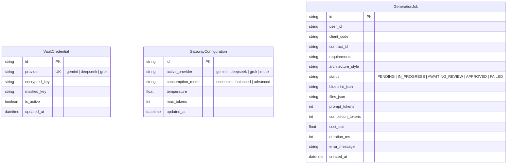

# Phase 1 Data Model: Spec 003 — ai-orchestrator-service

## 1. Domain Entities & Database Schema

### 1.1 `vault_credentials` Table
Stores Fernet-encrypted API keys for AI model providers.

| Column | Type | Constraints | Description |
|---|---|---|---|
| `id` | VARCHAR(36) | PRIMARY KEY | UUIDv4 string identifier |
| `provider` | VARCHAR(50) | UNIQUE, NOT NULL | Provider name: `gemini`, `deepseek`, `grok` |
| `encrypted_key` | TEXT | NOT NULL | Base64-encoded Fernet cipher text |
| `masked_key` | VARCHAR(50) | NOT NULL | Sanitized display string (e.g. `sk-****a1b2`) |
| `is_active` | BOOLEAN | NOT NULL, DEFAULT TRUE | Status of the credential |
| `created_at` | DATETIME | NOT NULL | UTC creation timestamp |
| `updated_at` | DATETIME | NOT NULL | UTC last update timestamp |

### 1.2 `gateway_configurations` Table
Stores active AI provider, model name, and parameters (direct API & model ingestion).

| Column | Type | Constraints | Description |
|---|---|---|---|
| `id` | VARCHAR(36) | PRIMARY KEY | UUIDv4 string identifier |
| `active_provider` | VARCHAR(50) | NOT NULL, DEFAULT `'mock'` | Active provider: `gemini`, `deepseek`, `grok`, `mock` |
| `model_name` | VARCHAR(100) | NULLABLE | Specific model identifier (e.g. `gemini-2.5-flash`, `deepseek-chat`) |
| `consumption_mode` | VARCHAR(30) | NOT NULL, DEFAULT `'standard'` | Legacy/fallback compatibility mode |
| `temperature` | FLOAT | NOT NULL, DEFAULT 0.2 | Sampling temperature |
| `max_tokens` | INTEGER | NOT NULL, DEFAULT 8192 | Maximum output tokens per generation call |
| `updated_at` | DATETIME | NOT NULL | UTC timestamp of last adjustment |

### 1.3 `generation_jobs` Table
Stores state, blueprint, generated artifacts, and telemetry of microservice generation runs.

| Column | Type | Constraints | Description |
|---|---|---|---|
| `id` | VARCHAR(36) | PRIMARY KEY | UUIDv4 string identifier |
| `user_id` | VARCHAR(36) | NOT NULL, INDEX | Creator collaborator UUID |
| `client_code` | VARCHAR(64) | NOT NULL, INDEX | Client account association |
| `contract_id` | VARCHAR(36) | NULLABLE | Associated OpenAPI contract UUID |
| `requirements` | TEXT | NOT NULL | Natural language business requirements |
| `architecture_style` | VARCHAR(50) | NULLABLE | `Hexagonal`, `Layered`, `Event-Driven`, `BFF`, `gRPC` |
| `status` | VARCHAR(30) | NOT NULL | `PENDING`, `IN_PROGRESS`, `AWAITING_REVIEW`, `APPROVED`, `FAILED` |
| `blueprint_json` | TEXT | NULLABLE | JSON string of architectural blueprint & custom user inputs (`entities`, `endpoints`, `extensions`, `properties`, etc.) |
| `files_json` | TEXT | NOT NULL, DEFAULT `'{}'` | JSON dict mapping file paths to file contents |
| `prompt_tokens` | INTEGER | NOT NULL, DEFAULT 0 | Cumulative prompt tokens consumed |
| `completion_tokens` | INTEGER | NOT NULL, DEFAULT 0 | Cumulative completion tokens consumed |
| `cost_usd` | FLOAT | NOT NULL, DEFAULT 0.0 | Estimated cost in USD |
| `duration_ms` | INTEGER | NOT NULL, DEFAULT 0 | Execution duration in milliseconds |
| `error_message` | TEXT | NULLABLE | Details if execution failed |
| `created_at` | DATETIME | NOT NULL | UTC creation timestamp |
| `updated_at` | DATETIME | NOT NULL | UTC last update timestamp |

### 1.4 `JobCreateRequest` Input Payload (Pydantic v2)
Estructura extendida para permitir el ingreso libre de todos los parámetros de personalización:

```json
{
  "client_code": "ibk",
  "artifact_id": "ibk-transfers-service",
  "package_prefix": "pe.com.interbank",
  "http_port": 8080,
  "java_version": "21",
  "requirements": "Microservicio bancario de transferencias interbancarias...",
  "architecture_style": "Hexagonal",
  "custom_architecture_notes": "Separar capas con puertos in/out e inmutabilidad en Value Objects.",
  "security_option": "JWT",
  "jwt_issuer": "https://auth.interbank.pe",
  "security_roles": ["ADMIN", "OPERATOR", "AUDITOR"],
  "communication_protocol": "REST",
  "custom_endpoints": [
    { "method": "POST", "path": "/api/v1/transfers", "summary": "Ejecutar transferencia" },
    { "method": "GET", "path": "/api/v1/transfers/{id}", "summary": "Consultar transferencia" }
  ],
  "database_option": "POSTGRESQL_PANACHE",
  "database_name": "ibk_transfers_db",
  "entities": [
    {
      "name": "Transfer",
      "tableName": "transfers",
      "fields": [
        { "name": "id", "type": "String", "required": true, "isId": true },
        { "name": "amount", "type": "BigDecimal", "required": true }
      ]
    }
  ],
  "extensions": [
    "quarkus-resteasy-reactive-jackson",
    "quarkus-smallrye-openapi",
    "quarkus-smallrye-health"
  ],
  "custom_extensions": ["quarkus-mailer", "quarkus-hibernate-validator"],
  "custom_properties": {
    "interbank.transfers.daily-limit": "50000.00",
    "interbank.audit.enabled": "true"
  }
}
```

---

## 2. Entity Relationships (ERD)



