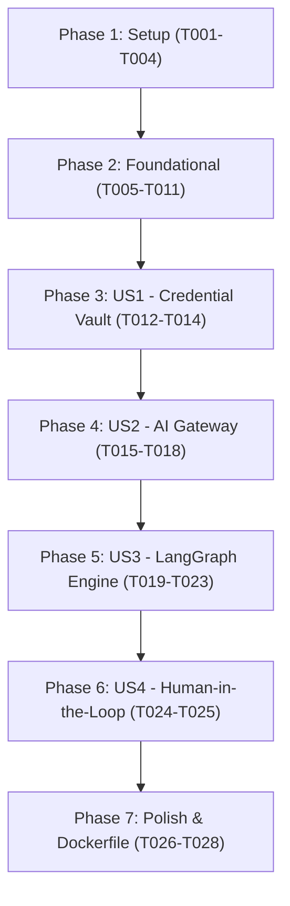

# Tasks: Spec 003 — ai-orchestrator-service

**Input**: Design documents from `/specs/003-ai-orchestrator-service/` (`spec.md`, `plan.md`, `research.md`, `data-model.md`, `contracts/openapi.json`, `quickstart.md`)
**Version Alignment**: Constitution `v1.2.0` (Principles I, II, IV, VIII, IX, XII, XIII, XIV)

## Format: `[ID] [P?] [Story] Description`
- **[P]**: Can run in parallel (different files, no dependencies)
- **[Story]**: Associated User Story (`[US1]`, `[US2]`, `[US3]`, `[US4]`)

---

## Phase 1: Setup (Shared Infrastructure)

**Purpose**: Microservice directory structure, dependencies, and environment configuration.

- [x] T001 Create microservice directory structure in `services/ai-orchestrator-service/app/` (`api/v1`, `core`, `models`, `schemas`, `llm`, `graph`) and `services/ai-orchestrator-service/tests/`.
- [x] T002 [P] Create `services/ai-orchestrator-service/requirements.txt` with dependencies (`fastapi`, `uvicorn`, `pydantic>=2.0`, `sqlalchemy>=2.0`, `cryptography`, `pyjwt`, `httpx`, `python-dotenv`, `pytest`).
- [x] T003 [P] Create `services/ai-orchestrator-service/app/core/config.py` with settings for `PORT=8003`, `DATABASE_URL` (SQLite `sqlite:///./orchestrator_factory_local.db`), `VAULT_MASTER_KEY`, `GOVERNANCE_SERVICE_URL`, `JWT_SECRET_KEY`, `JWT_ALGORITHM`.
- [x] T004 [P] Create `services/ai-orchestrator-service/app/core/database.py` with SQLAlchemy engine, `sessionmaker`, and declarative `Base`.

---

## Phase 2: Foundational (Blocking Prerequisites)

**Purpose**: Fernet encryption vault engine, resilient JSON parser, database models, and FastAPI application on port 8003.

- [x] T005 [P] Implement Fernet encryption and decryption engine in `services/ai-orchestrator-service/app/core/vault.py`.
- [x] T006 [P] Implement resilient JSON parser and repair utility in `services/ai-orchestrator-service/app/core/parser.py`.
- [x] T007 [P] Create domain ORM models (`VaultCredential`, `GatewayConfig`, `GenerationJob`) in `services/ai-orchestrator-service/app/models/`.
- [x] T008 [P] Create Pydantic v2 schemas in `services/ai-orchestrator-service/app/schemas/` (`vault.py`, `gateway.py`, `job.py`).
- [x] T009 Implement authentication & tenant access verification dependency in `services/ai-orchestrator-service/app/api/deps.py` (`get_verified_user`, `require_admin`, `verify_client_access`).
- [x] T010 Create FastAPI application entrypoint in `services/ai-orchestrator-service/app/main.py` on port 8003 with CORS, DB initialization on startup, and `GET /api/v1/health`.
- [x] T011 [P] Setup test infrastructure and fixtures in `services/ai-orchestrator-service/tests/conftest.py`.

**Checkpoint**: Foundation ready. Microservice starts on port 8003 with `/api/v1/health` and vault/parser engines configured.

---

## Phase 3: User Story 1 - Bóveda de Credenciales Cifradas y Conectividad (Priority: P1) [MVP]

**Goal**: Admins store, rotate, and test AI provider credentials encrypted in reposo using Fernet; keys are never exposed in plain text.

**Independent Test**: Execute `test_vault.py` verifying credential encryption, key masking (`AIza...1234`), connection testing, and 403 for non-admins.

### Tests for User Story 1
- [x] T012 [P] [US1] Create automated tests in `services/ai-orchestrator-service/tests/test_vault.py` testing key encryption, retrieval masking, duplicate provider update, connection test, and non-admin rejection (403).

### Implementation for User Story 1
- [x] T013 [US1] Implement `POST /api/v1/vault/keys`, `GET /api/v1/vault/keys`, and `POST /api/v1/vault/test-connection` in `services/ai-orchestrator-service/app/api/v1/vault.py`.
- [x] T014 [US1] Wire vault router into `services/ai-orchestrator-service/app/api/v1/api.py`.

**Checkpoint**: User Story 1 is functional and tested independently.

---

## Phase 4: User Story 2 - Gateway de Modelos de IA con Conmutación en Caliente (Priority: P1)

**Goal**: Hot-switch active AI providers (`gemini`, `deepseek`, `grok`, `mock`) and operational modes (`economic`, `balanced`, `advanced`) without restarting the service.

**Independent Test**: Execute `test_gateway.py` verifying dynamic provider switching, mode parameters, and gateway retrieval.

### Tests for User Story 2
- [x] T015 [P] [US2] Create automated tests in `services/ai-orchestrator-service/tests/test_gateway.py` testing gateway retrieval, hot-update of active provider/mode, and invalid mode rejection.

### Implementation for User Story 2
- [x] T016 [US2] Implement LLM clients hierarchy in `services/ai-orchestrator-service/app/llm/` (`base.py`, `factory.py`, `mock_client.py`, `gemini_client.py`, `openai_compat.py`).
- [x] T017 [US2] Implement `GET /api/v1/ai-gateway/config` and `PUT /api/v1/ai-gateway/config` in `services/ai-orchestrator-service/app/api/v1/gateway.py`.
- [x] T018 [US2] Wire gateway router into `services/ai-orchestrator-service/app/api/v1/api.py`.

**Checkpoint**: AI Gateway with hot-switching is functional and tested.

---

## Phase 5: User Story 3 - Motor de Generación Multi-Agente LangGraph (Priority: P1)

**Goal**: Execute stateful generation pipeline (Blueprint -> Scaffolding -> Domain -> Tests) selecting justified architecture and producing Quarkus microservices with token/cost telemetry.

**Independent Test**: Execute `test_orchestrator.py` verifying job creation, LangGraph node execution, adaptive architecture selection, and file generation.

### Tests for User Story 3
- [x] T019 [P] [US3] Create automated tests in `services/ai-orchestrator-service/tests/test_parser.py` testing resilient JSON parsing (markdown stripping, unclosed quotes, brackets, and braces auto-repair).
- [x] T020 [P] [US3] Create automated tests in `services/ai-orchestrator-service/tests/test_orchestrator.py` testing job creation, LangGraph execution, adaptive architecture generation, and client isolation.

### Implementation for User Story 3
- [x] T021 [US3] Implement LangGraph state and nodes in `services/ai-orchestrator-service/app/graph/` (`state.py`, `nodes.py`, `workflow.py`).
- [x] T022 [US3] Implement `POST /api/v1/orchestrator/jobs` and `GET /api/v1/orchestrator/jobs/{job_id}` in `services/ai-orchestrator-service/app/api/v1/orchestrator.py`.
- [x] T023 [US3] Wire orchestrator router into `services/ai-orchestrator-service/app/api/v1/api.py`.

**Checkpoint**: Multi-agent code generation is functional and tested.

---

## Phase 6: User Story 4 - Supervisión Humana (Human-in-the-Loop) y Aprobación (Priority: P2)

**Goal**: Developers inspect generated code, edit files in place, and approve the project before sending to the compilation sandbox.

**Independent Test**: Execute tests in `test_orchestrator.py` verifying file editing via `PATCH /files` and final approval via `POST /approve`.

### Tests for User Story 4
- [x] T024 [P] [US4] Add tests in `services/ai-orchestrator-service/tests/test_orchestrator.py` for file modification by developer, approval state change (`APPROVED`), and unassigned developer rejection (403).

### Implementation for User Story 4
- [x] T025 [US4] Implement `PATCH /api/v1/orchestrator/jobs/{job_id}/files` and `POST /api/v1/orchestrator/jobs/{job_id}/approve` in `services/ai-orchestrator-service/app/api/v1/orchestrator.py`.

**Checkpoint**: Human-in-the-loop workflows are fully functional and tested.

---

## Phase 7: Polish & Operational Hardening

**Purpose**: Containerization, production documentation, and execution verification.

- [x] T026 [P] Create `services/ai-orchestrator-service/Dockerfile` exposing port 8003.
- [x] T027 [P] Create `services/ai-orchestrator-service/README.md` with route documentation.
- [x] T028 Run the complete multi-service test runner and verify 100% passing tests.

---

## Dependencies & Execution Order

