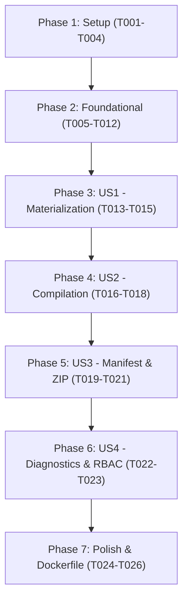

# Tasks: Spec 004 — sandbox-verifier-service

**Input**: Design documents from `/specs/004-sandbox-verifier-service/` (`spec.md`, `plan.md`, `research.md`, `data-model.md`, `contracts/openapi.json`, `quickstart.md`)
**Version Alignment**: Constitution `v1.2.0` (Principles VI, XIII, XIV)

## Format: `[ID] [P?] [Story] Description`
- **[P]**: Can run in parallel (different files, no dependencies)
- **[Story]**: Associated User Story (`[US1]`, `[US2]`, `[US3]`, `[US4]`)

---

## Phase 1: Setup (Shared Infrastructure)

**Purpose**: Microservice directory structure, dependencies, and environment configuration.

- [x] T001 Create microservice directory structure in `services/sandbox-verifier-service/app/` (`api/v1`, `core`, `models`, `schemas`) and `services/sandbox-verifier-service/tests/`.
- [x] T002 [P] Create `services/sandbox-verifier-service/requirements.txt` with dependencies (`fastapi`, `uvicorn`, `pydantic>=2.0`, `sqlalchemy>=2.0`, `pyjwt`, `httpx`, `python-dotenv`, `pytest`).
- [x] T003 [P] Create `services/sandbox-verifier-service/app/core/config.py` with settings for `PORT=8004`, `DATABASE_URL` (SQLite `sqlite:///./verifier_factory_local.db`), `SANDBOX_BASE_PATH`, `JWT_SECRET_KEY`, `JWT_ALGORITHM`.
- [x] T004 [P] Create `services/sandbox-verifier-service/app/core/database.py` with SQLAlchemy engine, `sessionmaker`, and declarative `Base`.

---

## Phase 2: Foundational (Blocking Prerequisites)

**Purpose**: Compiler execution engine, cryptographic SHA-256 manifest generator, ZIP packager, database models, and FastAPI app on port 8004.

- [x] T005 [P] Implement compilation execution runner (Maven + resilient Java/Quarkus syntax validator) in `services/sandbox-verifier-service/app/core/compiler.py`.
- [x] T006 [P] Implement SHA-256 hash generator and manifest writer (`VERIFICATION_MANIFEST.json`) in `services/sandbox-verifier-service/app/core/manifest.py`.
- [x] T007 [P] Implement ZIP archive creator in `services/sandbox-verifier-service/app/core/packager.py`.
- [x] T008 [P] Create domain ORM model `VerificationRun` in `services/sandbox-verifier-service/app/models/run.py`.
- [x] T009 [P] Create Pydantic v2 schemas in `services/sandbox-verifier-service/app/schemas/verifier.py`.
- [x] T010 Implement authentication & tenant access verification dependency in `services/sandbox-verifier-service/app/api/deps.py` (`get_verified_user`, `verify_client_access`).
- [x] T011 Create FastAPI application entrypoint in `services/sandbox-verifier-service/app/main.py` on port 8004 with CORS, DB initialization on startup, and `GET /api/v1/health`.
- [x] T012 [P] Setup test infrastructure and fixtures in `services/sandbox-verifier-service/tests/conftest.py`.

**Checkpoint**: Foundation ready. Microservice starts on port 8004 with `/api/v1/health` and compiler/manifest engines configured.

---

## Phase 3: User Story 1 - Materialización Efímera y Seguridad (Priority: P1) [MVP]

**Goal**: Materialize generated microservice files into an isolated ephemeral workspace while enforcing strict path traversal protection.

**Independent Test**: Execute `test_security.py` verifying that malicious file paths (e.g. `../../etc/passwd`) are rejected with 400 Bad Request, and valid files are written properly.

### Tests for User Story 1
- [x] T013 [P] [US1] Create automated tests in `services/sandbox-verifier-service/tests/test_security.py` testing path traversal detection, illegal filenames, and safe directory creation.

### Implementation for User Story 1
- [x] T014 [US1] Implement safe file materialization helper in `services/sandbox-verifier-service/app/core/packager.py`.
- [x] T015 [US1] Implement run initialization logic in `services/sandbox-verifier-service/app/api/v1/verifier.py`.

**Checkpoint**: Materialization is safe and verified independently.

---

## Phase 4: User Story 2 - Compilación Real y Pruebas Surefire (Priority: P1)

**Goal**: Execute real Maven compilation or resilient Java/Quarkus syntax checks, capturing output, status, and duration.

**Independent Test**: Execute `test_compiler.py` verifying successful compilation for valid code and compilation failure detection for invalid syntax.

### Tests for User Story 2
- [x] T016 [P] [US2] Create automated tests in `services/sandbox-verifier-service/tests/test_compiler.py` testing compilation of valid Quarkus project, compilation error handling, and compiler diagnostics capture.

### Implementation for User Story 2
- [x] T017 [US2] Implement compilation execution in `services/sandbox-verifier-service/app/api/v1/verifier.py` (`POST /api/v1/verifier/runs`).
- [x] T018 [US2] Implement `GET /api/v1/verifier/runs/{run_id}` in `services/sandbox-verifier-service/app/api/v1/verifier.py`.

**Checkpoint**: Compilation runner is functional and tested.

---

## Phase 5: User Story 3 - Manifiesto Criptográfico SHA-256 y Descarga ZIP (Priority: P1)

**Goal**: Compute deterministic SHA-256 hashes for all files, write `VERIFICATION_MANIFEST.json`, and expose ZIP binary download.

**Independent Test**: Execute `test_manifest.py` verifying SHA-256 hashes match file contents and `GET /download` delivers valid zip archive.

### Tests for User Story 3
- [x] T019 [P] [US3] Create automated tests in `services/sandbox-verifier-service/tests/test_manifest.py` verifying SHA-256 manifest integrity, inclusion in zip, and zip download endpoint.

### Implementation for User Story 3
- [x] T020 [US3] Implement `GET /api/v1/verifier/runs/{run_id}/manifest` and `GET /api/v1/verifier/runs/{run_id}/download` in `services/sandbox-verifier-service/app/api/v1/verifier.py`.
- [x] T021 [US3] Wire verifier router into `services/sandbox-verifier-service/app/api/v1/api.py`.

**Checkpoint**: Manifest and ZIP download are functional and tested.

---

## Phase 6: User Story 4 - Diagnósticos y Trazabilidad (Priority: P2)

**Goal**: Provide detailed compiler diagnostics and client isolation across runs.

**Independent Test**: Execute tests in `test_verifier.py` testing unassigned developer rejection (403) and diagnostics extraction.

### Tests for User Story 4
- [x] T022 [P] [US4] Add tests in `services/sandbox-verifier-service/tests/test_verifier.py` validating client isolation (403 when developer queries another client's run).

### Implementation for User Story 4
- [x] T023 [US4] Enforce `verify_client_access` on all verifier endpoints.

---

## Phase 7: Polish & Operational Hardening

**Purpose**: Containerization, production documentation, and execution verification.

- [x] T024 [P] Create `services/sandbox-verifier-service/Dockerfile` exposing port 8004.
- [x] T025 [P] Create `services/sandbox-verifier-service/README.md` documenting routes.
- [x] T026 Run the multi-service test runner and verify 100% passing tests.

---

## Dependencies & Execution Order

